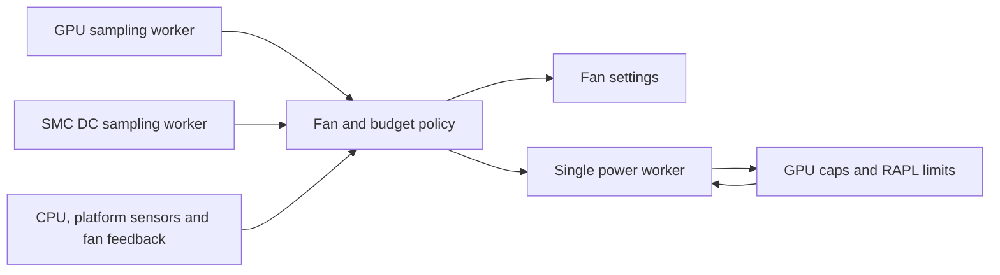

# macpro-fand 2.0.0 engineering handoff

The Rust daemon implements the 1.0.6 fan and power policy, with the same configuration, override and service paths.
It passed hardware qualification on the Mac Pro 7,1 on 2026-10-06: all 27 hardware tests, run against the exact
executable the 2.0.0 package installs (SHA-256 `cafed83a4db8b6d76c7e9cfe78b5a8f83a81aebeaf135e113e6ce5acc0d26d1d`).
The 1.0.6 results do not stand in for these; the suite ran against the native executable itself. It costs the machine
less than 1.0.6 on every measure but thread count (see Resource cost).

## Specification and scope

The specification is the published 1.0.6 source at commit
`bb544db4bfcd9324302478defb88223720019e62`, retained unmodified in
[`reference/v1.0.6/macpro-fand.py`](../reference/v1.0.6/macpro-fand.py). Its SHA-256 is
`4bb1f2e700249308333f63bf3b5fccc441e4dd2e90ab3941ae3ddc77a7adbc8f`.
The differential suite refuses a modified reference. Its old Python tests are retained for context; they are not
counted as tests of the Rust implementation. The experiment tools, calibration scripts and published research
results are outside this rewrite.

Release 2.0.0 is built from the commit tagged `macpro-fand-2.0.0`; package builds are reproducible (two clean builds
from different directories give identical files).

## Implementation map

| Module | Responsibility |
|---|---|
| `src/config.rs`, `src/literal.rs` | Defaults, bounded non-executing literal parser, atomic validation, overrides, JSON |
| `src/control.rs` | Governors, filters, CPU target, RAPL energy accounting, fan health |
| `src/budget.rs` | Water filling, CPU priority, thermal ceilings, pins, backstop, conservative charge, static plans |
| `src/transaction.rs` | Read/decrease/stage/raise transaction, read-back verification, CPU write ordering |
| `src/power.rs` | Single writer, generations, reconciliation, per-read timestamps, bounded quiescence and recovery |
| `src/hardware.rs` | Discovery, sysfs adapters, GPU sampler, SMC key sampler, fan writes |
| `src/os.rs` | Linux locks and signals, bounded child commands, systemd notifications and service queries |
| `src/runtime.rs` | CLI, sensor/alarm policy, ownership, startup, control loop, stop hook and cleanup |



There are no third-party crates or runtime calls to Python. The supported target is x86-64 Linux, the Mac Pro 7,1
platform; the Linux ABI constants and native package are explicitly restricted to this target. Rust 1.75 is the
tested minimum. All unsafe code is in
the small Linux ABI adapter for `flock`, `geteuid`, `getppid` and signal registration. The CLI provides no alternative
sysfs-root option; test fixtures inject paths through library interfaces. No new network listener or IPC command
surface is introduced.

## Safety guarantees carried over

The planner charges uncapped dies at 200 W, and an unenforced or unreadable uncontrolled CPU at 413 W. CPU charges
apply to demand changes, override pins, pin reset and static recovery. Feasibility is checked each loop. An
infeasible allocation alarms, sets all fans to full speed and permits only decreases.

Every transaction reads its managed limits, lowers known excesses, stages unreadable values at 10 W, confirms
them and only then raises limits. PL1 precedes PL2 when lowering; PL2 precedes PL1 when raising. Each write must
read back at or below its target, within 1 W. The first failure stops the transaction. Each sysfs value is sent in one complete write; a partial store fails
without retrying a suffix as a new limit. Planned limits are whole
watts rounded down. A newer allocation or stop supersedes a transaction before its next operation.

The 10 W staging exception remains explicit: a limit set externally below 10 W can rise to 10 W when unreadable.
Its maximum modeled increment for four dies and one CPU with default coefficients is
`10 × (4 × 1.205 + 1.156) = 59.76 W`, within the default 80 W margin. This is not a proof for custom coefficients,
margins or die counts. External uncooperative writers and firmware transients remain assumptions of the model.

Stop sets all fans to full speed before waiting for the worker. Static recovery starts only when the worker is
permanently idle. A kernel write that remains stuck cannot be cancelled; the daemon reports incomplete recovery
and starts no competing transaction. Both the worker and detached recovery I/O retain a shared owner-lock fd
until their outstanding call ends, preventing a new controller from taking over prematurely. Recovery uses a single ten-second deadline. Only confirmed, feasible
recovery permits a clean handover to t2fanrd. The stop hook acquires the owner lock and leaves another owner alone.

## Deliberate differences from 1.0.6

* DC sampling runs in its own thread. Its readings carry their start time and become unusable after ten seconds;
  sustained missing telemetry pauses demand allocation. GPU sampling already follows this model.
* Known missing dies or an infeasible startup allocation start with full cooling. Fan-write failures terminate the
  session and invoke full cooling and recovery. Foreground failure cleanup never starts t2fanrd.
* Ownership errors fail closed. Unlike the Python hook's “recovering anyway” branch, an unverifiable lock changes
  no hardware. Lock directories must belong to the controlling uid and deny writes to other users; files reject
  symlinks, hard links and non-regular types. Incomplete stop-hook recovery returns exit status 1.
* Service-query failures are errors, rather than evidence that t2fanrd is absent. Child commands have deadlines
  and do not inherit `NOTIFY_SOCKET`. A masked or invalid handover service is reported as failure.
* Configuration reports the first error, with nothing committed. Its literal syntax is bounded to 128 KiB per
  regular UTF-8 file, 32 levels of nesting, 16384 nodes per setting and 8 KiB per string. Normal strings, finite
  numbers, tuples, lists, dictionaries, booleans and None are supported; bytes, raw/triple-quoted strings and
  expressions are rejected. Non-regular configs cannot stall recovery by opening a FIFO. Override files reject
  symlinks, binary content and oversized/non-regular files.
* Fault-injection environment settings must be finite and bounded; a test hook cannot enlarge the configured
  power envelope. Worker panics are observable failures, and status `confirmed` refers to the current allocation
  generation. Die discovery retains at most one outstanding probe per die.

Unsupported GPU models continue to be logged, rather than refused, as in the specification. The Vega 20 model and
calibration remain required for the stated physical power bounds. Synchronous platform/fan sysfs calls retain the
systemd watchdog protection; a stuck driver is not made cancellable by the language rewrite.

## Offline evidence

Run `make check` and `make fmt` from the source root. No root privileges, GPU or real service calls are required.
The normal tests use in-memory power adapters, temporary sysfs inventories and service fakes. The real CLI is
exercised on version/help, argument errors and invalid configurations that exit before hardware discovery.

| Check | Coverage |
|---|---|
| Rust safety tests | 43 tests, including malformed config, ownership, sensor alarms, RAPL loss/recovery, pins, external writes, worker panic, shutdown and deadline behavior |
| Allocation property loop | 20,000 demand transitions with budget/range/whole-watt assertions |
| Unreadable-limit property loop | 6,144 combinations, including CPU targets at 10 W and caps below raised floors; every intermediate write state checked |
| Python/Rust differential suite | 2,958 scenarios, 577,762 compared fields, including 20,000 allocation transitions |
| Real executable CLI | 18 checks, including binary, fractional, zero-cap and FIFO configurations |
| Formatting and lint | rustfmt and Clippy with warnings treated as errors |
| Debian build | Native package, built with locked/offline Cargo dependencies and all normal tests enabled |
| Ordinary-user build | Verified: the whole package build, tests included, as `nobody` with no GPU, NVMe or hwmon devices visible; same executable bytes as the root build. `Rules-Requires-Root: no` is preserved. |
| Reproducibility | Two clean builds from different directories give identical package files. |

Differential tests establish equality of the policy calculations on those inputs, not equality of every possible
thread interleaving or driver behavior. The in-memory and filesystem tests check the actual transaction worker,
policy engine and cleanup paths; the hardware-facing adapters still need on-device verification.

## Hardware qualification

[`tests/hardware/run-tests.sh`](../tests/hardware/run-tests.sh) is adapted from the 1.0.6 suite to execute the native
binary directly. It retains the original workload/telemetry prerequisites, fixed test-machine PCI inventory and
state restoration. It computes its static-safe expectation using the pinned Python specification, not by importing
the ELF executable. It is excluded from `make check` and package build tests, and has only been syntax checked.

On the idle calibrated machine, provide a GPU burner, a CPU load helper and the SMC reader for measured DC power
(see the runner's header for their interfaces). The runner takes the experiment lock, snapshots/restores the override
and installed owner's state, and records the selected executable's SHA-256.

```sh
# Operator step on the calibrated machine, after reviewing the runner and ensuring it is idle:
BIN=/path/to/extracted/usr/sbin/macpro-fand \
BURN=/path/to/gpuburn CPU_LOAD=/path/to/cpuload.sh SMC_LIB=/path/to/dir-with-smc.py \
    bash tests/hardware/run-tests.sh
```

The suite covers service restart/watchdog, stale telemetry, fan failure, backstop, pin reset and owner transitions,
with both the shipped 125 W ceiling (T22) and the suite's 200 W ceiling. Raised floors/unreadable-limit injection and
kernel-write stalls remain offline cases; do not introduce these faults on real hardware.

Results on the Mac Pro 7,1 (Xeon W-3275M, two Radeon Pro Vega II Duo, Ubuntu 24.04, kernel 7.0.0-38), 2026-10-06:

| Executable (SHA-256) | Result |
|---|---|
| `bbe85f22…` (as first delivered) | 27/27 |
| `cafed83a…` (the 2.0.0 release: sampler sleep fix below) | 27/27 |

Every executable in a hardware log is recorded by hash; the release's executable is the second. Keep the signed
1.0.6 package available for rollback. Installing either package starts its service.

## Resource cost

Measured on the same machine with the same configuration, each version running as the installed service, alternating
1.0.6, 2.0.0, 1.0.6, 2.0.0 for 600 s idle windows (after 120 s settling), then 300 s each under a four-die GPU burn, and
three restarts each. CPU time is the service cgroup's (every thread and child); memory is the daemon's
`smaps_rollup`; wakeups are voluntary plus involuntary context switches of every thread; syscalls and instructions
come from perf counters.

| Measure | 1.0.6 (Python) | 2.0.0 (Rust) | Change |
|---|---|---|---|
| CPU, idle | 0.667 % of a core (24.0 s/h) | 0.534 % (19.2 s/h) | -20 % |
| CPU, four-die GPU load | 0.680 % | 0.556 % | -18 % |
| User-space CPU | 5.1 s/h | 0.6 s/h | -88 % |
| Kernel CPU (sensor and limit I/O) | 18.9 s/h | 18.6 s/h | same |
| Memory, PSS / private | 13.4 / 12.2 MB | 1.66 / 1.59 MB | -88 % |
| Service cgroup memory | 14-15 MB | 2-4 MB | -80 % |
| Wakeups | 83 /s | 83 /s | same |
| Syscalls | 235 /s | 117 /s | -50 % |
| Instructions / cycles | 3.10 M / 6.7 M per s | 1.56 M / 5.2 M per s | -50 % / -22 % |
| Threads | 3 | 4 | +1 (the DC sampler) |
| Start to READY | 1.23 s | 1.10 s | -11 % |
| CPU used by READY | 212 ms | 89 ms | -58 % |
| Peak memory by READY | 13.9 MB | 2.6 MB | -81 % |
| Runtime dependency | python3 (63 MB interpreter + standard library) | libc, libgcc | Python removed |

The two idle rounds of each version agree within 1 %. Both versions spend almost all their CPU in the kernel, reading
sensors and limits through sysfs (the SMC reads cross the T2); that cost is the same work in either language, and so
are the wakeups, which come from those blocking reads. What the rewrite removes is the interpreter: user-space CPU,
half the syscalls and seven eighths of the memory.

The first delivered executable measured worse than 1.0.6 on CPU (0.78 %) and wakeups (138 /s): its control loop and
both sampler threads slept in 50 ms slices to poll their stop flags, 60 wakeups a second with nothing to do. The
samplers now sleep on a condition variable that a stop wakes at once, and the control loop checks the
signal-handler flag every 500 ms (1.0.6 checked it every 2 s). That change is the only difference between the two
qualified executables.
