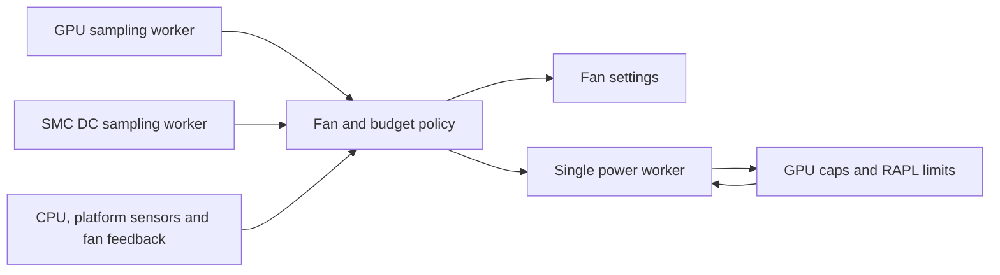

# macpro-fand 2.0.0 engineering handoff

The Rust daemon implements the 1.0.6 fan and power policy, with the same configuration, override and service paths.
It passed hardware qualification on the Mac Pro 7,1 on 2026-10-06: all 27 hardware tests, run against the exact
executable the 2.0.0 package installs (SHA-256 `cafed83a4db8b6d76c7e9cfe78b5a8f83a81aebeaf135e113e6ce5acc0d26d1d`).
The 1.0.6 results do not stand in for these; the suite ran against the native executable itself. It costs the machine
less than 1.0.6 on every measure but thread count (see Resource cost).

## Specification and scope

The specification is the published 1.0.6 source at commit
`bb544db4bfcd9324302478defb88223720019e62`, retained unmodified in
[`reference/v1.0.6/macpro-fand.py`](../reference/v1.0.6/macpro-fand.py). Its SHA-256 is
`4bb1f2e700249308333f63bf3b5fccc441e4dd2e90ab3941ae3ddc77a7adbc8f`.
The differential suite refuses a modified reference. Its old Python tests are retained for context; they are not
counted as tests of the Rust implementation. The experiment tools, calibration scripts and published research
results are outside this rewrite.

Release 2.0.0 is built from the commit tagged `macpro-fand-2.0.0`; package builds are reproducible (two clean builds
from different directories give identical files).

## Implementation map

| Module | Responsibility |
|---|---|
| `src/config.rs`, `src/literal.rs` | Defaults, bounded non-executing literal parser, atomic validation, overrides, JSON |
| `src/control.rs` | Governors, filters, CPU target, RAPL energy accounting, fan health |
| `src/budget.rs` | Water filling, CPU priority, thermal ceilings, pins, backstop, conservative charge, static plans |
| `src/transaction.rs` | Read/decrease/stage/raise transaction, read-back verification, CPU write ordering |
| `src/power.rs` | Single writer, generations, reconciliation, per-read timestamps, bounded quiescence and recovery |
| `src/hardware.rs` | Discovery, sysfs adapters, GPU sampler, SMC key sampler, fan writes |
| `src/inventory.rs` | 2.0.2: peripheral inventory (classes, slots, allowances), peripheral and command sensors, `UNMONITORED` floors |
| `src/sampling.rs` | 2.0.2: fan thread, platform temperature thread, per-sensor reader threads, sensor rescan |
| `src/os.rs` | Linux locks and signals, bounded child commands, systemd notifications and service queries |
| `src/runtime.rs` | CLI, sensor/alarm policy, ownership, startup, control loop, stop hook and cleanup |



There are no third-party crates or runtime calls to Python. The supported target is x86-64 Linux, the Mac Pro 7,1
platform; the Linux ABI constants and native package are explicitly restricted to this target. Rust 1.75 is the
tested minimum. All unsafe code is in
the small Linux ABI adapter for `flock`, `geteuid`, `getppid` and signal registration. The CLI provides no alternative
sysfs-root option; test fixtures inject paths through library interfaces. No new network listener or IPC command
surface is introduced.

## Safety guarantees carried over

The planner charges uncapped dies at 200 W, and an unenforced or unreadable uncontrolled CPU at 413 W. CPU charges
apply to demand changes, override pins, pin reset and static recovery. Feasibility is checked each loop. An
infeasible allocation alarms, sets all fans to full speed and permits only decreases.

Every transaction reads its managed limits, lowers known excesses, stages unreadable values at 10 W, confirms
them and only then raises limits. PL1 precedes PL2 when lowering; PL2 precedes PL1 when raising. Each write must
read back at or below its target, within 1 W. The first failure stops the transaction. Each sysfs value is sent in one complete write; a partial store fails
without retrying a suffix as a new limit. Planned limits are whole
watts rounded down. A newer allocation or stop supersedes a transaction before its next operation.

The 10 W staging exception remains explicit: a limit set externally below 10 W can rise to 10 W when unreadable.
Its maximum modeled increment for four dies and one CPU with default coefficients is
`10 × (4 × 1.205 + 1.156) = 59.76 W`, within the default 80 W margin. This is not a proof for custom coefficients,
margins or die counts. External uncooperative writers and firmware transients remain assumptions of the model.

Stop sets all fans to full speed before waiting for the worker. Static recovery starts only when the worker is
permanently idle. A kernel write that remains stuck cannot be cancelled; the daemon reports incomplete recovery
and starts no competing transaction. Both the worker and detached recovery I/O retain a shared owner-lock fd
until their outstanding call ends, preventing a new controller from taking over prematurely. Recovery uses a single ten-second deadline. Only confirmed, feasible
recovery permits a clean handover to t2fanrd. The stop hook acquires the owner lock and leaves another owner alone.

## Deliberate differences from 1.0.6

* DC sampling runs in its own thread. Its readings carry their start time and become unusable after ten seconds;
  sustained missing telemetry pauses demand allocation. GPU sampling already follows this model.
* Known missing dies or an infeasible startup allocation start with full cooling. Fan-write failures terminate the
  session and invoke full cooling and recovery. Foreground failure cleanup never starts t2fanrd.
* Ownership errors fail closed. Unlike the Python hook's “recovering anyway” branch, an unverifiable lock changes
  no hardware. Lock directories must belong to the controlling uid and deny writes to other users; files reject
  symlinks, hard links and non-regular types. Incomplete stop-hook recovery returns exit status 1.
* Service-query failures are errors, rather than evidence that t2fanrd is absent. Child commands have deadlines
  and do not inherit `NOTIFY_SOCKET`. A masked or invalid handover service is reported as failure.
* Configuration reports the first error, with nothing committed. Its literal syntax is bounded to 128 KiB per
  regular UTF-8 file, 32 levels of nesting, 16384 nodes per setting and 8 KiB per string. Normal strings, finite
  numbers, tuples, lists, dictionaries, booleans and None are supported; bytes, raw/triple-quoted strings and
  expressions are rejected. Non-regular configs cannot stall recovery by opening a FIFO. Override files reject
  symlinks, binary content and oversized/non-regular files.
* Fault-injection environment settings must be finite and bounded; a test hook cannot enlarge the configured
  power envelope. Worker panics are observable failures, and status `confirmed` refers to the current allocation
  generation. Die discovery retains at most one outstanding probe per die.

Unsupported GPU models continue to be logged, rather than refused, as in the specification. The Vega 20 model and
calibration remain required for the stated physical power bounds. Synchronous platform/fan sysfs calls retain the
systemd watchdog protection; a stuck driver is not made cancellable by the language rewrite.

## Offline evidence

Run `make check` and `make fmt` from the source root. No root privileges, GPU or real service calls are required.
The normal tests use in-memory power adapters, temporary sysfs inventories and service fakes. The real CLI is
exercised on version/help, argument errors and invalid configurations that exit before hardware discovery.

| Check | Coverage |
|---|---|
| Rust safety tests | 43 tests, including malformed config, ownership, sensor alarms, RAPL loss/recovery, pins, external writes, worker panic, shutdown and deadline behavior |
| Allocation property loop | 20,000 demand transitions with budget/range/whole-watt assertions |
| Unreadable-limit property loop | 6,144 combinations, including CPU targets at 10 W and caps below raised floors; every intermediate write state checked |
| Python/Rust differential suite | 2,958 scenarios, 577,762 compared fields, including 20,000 allocation transitions |
| Real executable CLI | 18 checks, including binary, fractional, zero-cap and FIFO configurations |
| Formatting and lint | rustfmt and Clippy with warnings treated as errors |
| Debian build | Native package, built with locked/offline Cargo dependencies and all normal tests enabled |
| Ordinary-user build | Verified: the whole package build, tests included, as `nobody` with no GPU, NVMe or hwmon devices visible; same executable bytes as the root build. `Rules-Requires-Root: no` is preserved. |
| Reproducibility | Two clean builds from different directories give identical package files. |

Differential tests establish equality of the policy calculations on those inputs, not equality of every possible
thread interleaving or driver behavior. The in-memory and filesystem tests check the actual transaction worker,
policy engine and cleanup paths; the hardware-facing adapters still need on-device verification.

## Hardware qualification

[`tests/hardware/run-tests.sh`](../tests/hardware/run-tests.sh) is adapted from the 1.0.6 suite to execute the native
binary directly. It retains the original workload/telemetry prerequisites, fixed test-machine PCI inventory and
state restoration. It computes its static-safe expectation using the pinned Python specification, not by importing
the ELF executable. It is excluded from `make check` and package build tests, and has only been syntax checked.

On the idle calibrated machine, provide a GPU burner, a CPU load helper and the SMC reader for measured DC power
(see the runner's header for their interfaces). The runner takes the experiment lock, snapshots/restores the override
and installed owner's state, and records the selected executable's SHA-256.

```sh
# Operator step on the calibrated machine, after reviewing the runner and ensuring it is idle:
BIN=/path/to/extracted/usr/sbin/macpro-fand \
BURN=/path/to/gpuburn CPU_LOAD=/path/to/cpuload.sh SMC_LIB=/path/to/dir-with-smc.py \
    bash tests/hardware/run-tests.sh
```

The suite covers service restart/watchdog, stale telemetry, fan failure, backstop, pin reset and owner transitions,
with both the shipped 125 W ceiling (T22) and the suite's 200 W ceiling. Raised floors/unreadable-limit injection and
kernel-write stalls remain offline cases; do not introduce these faults on real hardware.

Results on the Mac Pro 7,1 (Xeon W-3275M, two Radeon Pro Vega II Duo, Ubuntu 24.04, kernel 7.0.0-38), 2026-10-06:

| Executable (SHA-256) | Result |
|---|---|
| `bbe85f22…` (as first delivered) | 27/27 |
| `cafed83a…` (the 2.0.0 release: sampler sleep fix below) | 27/27 |

Every executable in a hardware log is recorded by hash; the release's executable is the second. Keep the signed
1.0.6 package available for rollback. Installing either package starts its service.

## Resource cost

Measured on the same machine with the same configuration, each version running as the installed service, alternating
1.0.6, 2.0.0, 1.0.6, 2.0.0 for 600 s idle windows (after 120 s settling), then 300 s each under a four-die GPU burn, and
three restarts each. CPU time is the service cgroup's (every thread and child); memory is the daemon's
`smaps_rollup`; wakeups are voluntary plus involuntary context switches of every thread; syscalls and instructions
come from perf counters.

| Measure | 1.0.6 (Python) | 2.0.0 (Rust) | Change |
|---|---|---|---|
| CPU, idle | 0.667 % of a core (24.0 s/h) | 0.534 % (19.2 s/h) | -20 % |
| CPU, four-die GPU load | 0.680 % | 0.556 % | -18 % |
| User-space CPU | 5.1 s/h | 0.6 s/h | -88 % |
| Kernel CPU (sensor and limit I/O) | 18.9 s/h | 18.6 s/h | same |
| Memory, PSS / private | 13.4 / 12.2 MB | 1.66 / 1.59 MB | -88 % |
| Service cgroup memory | 14-15 MB | 2-4 MB | -80 % |
| Wakeups | 83 /s | 83 /s | same |
| Syscalls | 235 /s | 117 /s | -50 % |
| Instructions / cycles | 3.10 M / 6.7 M per s | 1.56 M / 5.2 M per s | -50 % / -22 % |
| Threads | 3 | 4 | +1 (the DC sampler) |
| Start to READY | 1.23 s | 1.10 s | -11 % |
| CPU used by READY | 212 ms | 89 ms | -58 % |
| Peak memory by READY | 13.9 MB | 2.6 MB | -81 % |
| Runtime dependency | python3 (63 MB interpreter + standard library) | libc, libgcc | Python removed |

The two idle rounds of each version agree within 1 %. Both versions spend almost all their CPU in the kernel, reading
sensors and limits through sysfs (the SMC reads cross the T2); that cost is the same work in either language, and so
are the wakeups, which come from those blocking reads. What the rewrite removes is the interpreter: user-space CPU,
half the syscalls and seven eighths of the memory.

The first delivered executable measured worse than 1.0.6 on CPU (0.78 %) and wakeups (138 /s): its control loop and
both sampler threads slept in 50 ms slices to poll their stop flags, 60 wakeups a second with nothing to do. The
samplers now sleep on a condition variable that a stop wakes at once, and the control loop checks the
signal-handler flag every 500 ms (1.0.6 checked it every 2 s). That change is the only difference between the two
qualified executables.

## 2.0.2: peripherals and sensor I/O off the control thread

**Why.** On 2026-10-22 the control loop blocked for more than 20 s in one sysfs read (the Rust standard library's
32-byte probe read of an SMC/hwmon attribute) and systemd's watchdog killed the daemon. The peripherals installed on
2026-10-23 (two ConnectX-4 cards, a PM1725 NVMe card, two SATA HDDs and a USB-attached SATA SSD in a Sonnet Fusion Flex
J3i) add sensors whose reads are device commands: a drivetemp read issued during an HDD spin-up blocked 2.7 s on the
box, and a drive in error recovery can hold a command for 30 s or more.

**Threads.** The control loop (the watchdog keepalive) reads no device. `sampling::Platform` runs a fan thread (the
loop's settings written at once on a kick, tachometers and fan registers every 2 s, a fan another writer changed put
back) and a temperature thread (CPU package and SMC keys every 2 s); `DeviceReader` runs one thread per peripheral
sensor at its class's period (`PERIPH_POLL`); `Scanner` rediscovers peripheral sensors once a minute. The loop treats
readings older than their staleness limit as failed reads, so the alarm semantics are unchanged. The keepalive is
sent only while the fan thread completed a round within `IO_STALL` (60 s); a longer stall goes to the watchdog's
restart and failure path. The fan thread checks each fan's registers first and writes new settings after, and
skips a fan written less than `VERIFY_SETTLE` (1.5 s) ago: the SMC shows a write in its registers 13-203 ms later
(measured 2026-10-23), and the first hardware run, which checked straight after writing, raised false
"changed by another writer" alarms while the bay fans ramped under a GPU burn (T21/T22). Cleanup freezes the fan thread (under its write lock) before writing the caps, so no
thread write lands after them. What stays on the loop: RAPL powercap registers (MSR reads), the override file on
tmpfs, the journal.

**Peripheral sensors.** A sensor is armed by its first reading (one that never reads leaves its device unmonitored,
with a note after 60 s, instead of alarming); a sensor that read and stops goes stale (alarm); it is retired to the
device's `UNMONITORED` floor when its driver has been gone 20 s (before it goes stale, so a driver reload raises no
alarm) or it has read nothing for 600 s; a retired sensor
that reads again comes back. Sensors of USB and Thunderbolt devices steer no fan. `TEMP_COMMAND` runs a program for
cards with no hwmon (MFT `mget_temp` for ConnectX-4: no mlx5 hwmon on firmware 12.28 / 14.20), with a deadline of one
period (at most 10 s).

**Inventory.** `inventory::devices` charges every PCI function-0 endpoint (no VFs, no AMD) below a `SLOT_ZONE` slot
port, a card's switch once at its upstream port, and every SCSI disk; disks by the rotation rate they report (VPD B1),
the kernel's `rotational` flag only when there is none and never for USB disks. `DEVICE_PCI_W` overrides a class by
PCI id. `--inventory` prints all of it.

**Measurements (2026-10-23).** Zone test, one fan +600 rpm (blower +470) at a
time from 730/1150/1150/1150, every point at thermal equilibrium on its gated signals, effects interpolated between
bracketing baselines (`zone-test.py`, `zone-analysis.py`, run `zone-20261023-0503`; the blower point reached its cap:
the PM1725's 1 °C reading stepped once inside the trend window): middle fan -5.3 / -5.2 / -4.0 °C on the slot 5 / 6 / 7
cards; top fan -2.7 / -3.0 °C on the J3i HDDs and +3.2 / +2.9 °C on the slot 5 / 6 cards; bottom fan at most -1.4 °C on
any peripheral. The NIC temperatures (`mget_temp`, logged beside the test by `nic-temp-log.sh`, not in its gate) settled
within minutes of the fan 4 step and returned within minutes of the next point, while the CPU heatsink sensors
(TC0P-TC3P) took about 25 minutes, so the effect follows fan 4's airflow, not heat stored in the heatsink. No baffle
stops the top fan's air leaving through the auxiliary slot brackets in the middle fan's line, or the middle fan's air
leaving through the 3.5" bay, so a pressure difference between the two fans moves air across zones: the follow rule (fan
3 never slower than fan 4 while a card has no sensor) removes the difference that pushes the top lane into the slots.
The test ran idle (slot rail at most 51.3 W, no I/O): the slot 5-8 bracket vents pass little air, so a busy PM1725 or
NIC heats its neighbours by recirculation in the slot bay, and the half-height cards do not separate the zones the way
the full-height slot 8 I/O card does. NIC temperatures under that load are not measured. 36 minutes in, a second step
(+6.2 / +4.3 °C; the bay 2 GPU module +0.7-1 °C at the same moment, the CPU 0.5 °C cooler, bay 2 power +0.1 W) had held
15 minutes when the point qualified, so the matrix's +6.2 / +4.3 is not an equilibrium value; `zone-test.py` now gates
the cards when MFT is present. The HDD result was gated (30-minute trend window, with the heatsink sensors inside the
gate's 0.2 °C per 5 minutes). Hence `SLOT_ZONE` 5-7 -> fan 3, `DISK_ZONE` 4, `UNMONITORED` mellanox/pcie-card `(1000,
4)`. Power (`periph-power.py`, run `power-20261023-1222`, fans held 730/1500/1500/1500, increments bracketed by idle
windows): the three cards idle at 33.4 W together (SMC PZ5G 17.1 -> 50.5 W); the PM1725 adds at most +9.1 W on the slot
rail (sequential read); each HDD idles at 9.2 W (standby saves 18.3 W for both) and adds +6.6 W writing; a spin-up is
invisible at the SMC's 1 Hz. The class allowances (125 W for these six devices) cover the measured ~75 W (before NIC
traffic) with margin.

**Rerun (2026-10-23 18:16 to 10-24 02:01, `PLAN=rerun`, run `zone-20261023-1816`, NIC temperatures gated).** The cards
had been cabled at 16:39-16:41 (kernel log): the VPI card's two InfiniBand ports physically up (INIT, no subnet manager,
no traffic), the Lx port down. That raised the idle base at 730/1150/1150/1150 to 53.4 / 49.2 °C on the slot 5 / 6 cards
and the slot rail to 56.9 W (50.5 W uncabled), steady across the three baselines. Top fan +600 alone (`f4`): the cards
never settled in 100 minutes (cap 6000 s), their 5-minute means wandering 57-63 / 52-57 °C, +4 to +9 °C; the morning's
"second step" was this wandering, not a second state. HDDs -3.0 °C, PM1725 0. Top and middle fans both +600 (`f34`):
settled cleanly at -7.1 / -7.3 °C on the cards, HDDs still -3.0 °C, PM1725 -4.0 °C, bay 2 dies -3.0 °C: with no
difference between the two fans the cross-zone heating and the instability both go, and the HDDs keep the top fan's
cooling. PM1725 under a sustained sequential write (fio 128k QD32 x4, 1.7 GB/s; +9.3 W slot rail, +33 W DC with the host
side) at the base fans (`pm`): PM1725 +13.0 °C, slot 6 card (next to slot 7) +1.7 °C, slot 5 card 0.0 °C, CPU heatsink
+2.3 °C; with the middle fan +600 (`pm-f3`): PM1725 +6.0 °C over the idle base, the cards -8.0 / -7.2 °C. So the
PM1725's own heat reaches its neighbour by about 2 °C at this load, small next to the cross-zone effect; NIC traffic is
still untested (no subnet manager). This confirms `UNMONITORED` mellanox `(1000, 4)`: the follow rule keeps fan 3 from
falling below fan 4, which is the unstable case. Under 2.0.1, which lets the middle fan idle low, the cabled slot 5 card
idled at 63 °C (18:12).

**Hardware qualification (2026-10-23, kernel 7.0.0-38+barfix4, with the peripherals above).** First run
(`tests/hardware/results-20261023-1317-202.txt`, executable `760937f4`): 36/38. T14 failed on test calibration (its
900 W test budget left the dies no headroom above the CPU's share once the peripherals raised the base to 262 W; the
budget tests now use 900 + (base - 127) W). T29 checked a status line logged before the sensors came back (test
timing); its log also showed a 25 s stale alarm on a driver unload, hence `RETIRE_UNBOUND` 120 -> 20 s. T21/T22 passed
but logged false "changed by another writer" alarms: the fan thread checked a fan's registers microseconds after
writing them, and the SMC shows a write 13-203 ms later (measured) -> `VERIFY_SETTLE`, now asserted by T21/T22.
Second run on the fixed build (`results-20261023-1352-202b.txt`, executable `c0f1116b`): **38/38**. (Its exit status
read 1 from the last test's cleanup command; the runner now ends with `:` so only failures set it.)
Release qualification on the installed package (2026-10-24, `results-20261024-1834-202pkg.txt`, executable
`be3ef504`: the package build, which differs from `c0f1116b` only by Ubuntu's `RUSTFLAGS=-Cforce-frame-pointers=yes`):
**38/38** in 31 minutes; `failover-tests.sh` on the same package (`failover-20261024-1833-202pkg.txt`): **9/9**.

**Resource cost against 2.0.1** (2026-10-23: the
installed 2.0.1 service and the 2.0.2 build as a transient unit set up like the service, alternating, 300 s idle
windows after 60 s settling, 180 s under a four-die burn, three starts each): CPU 0.551 -> 0.568 % of a core idle
(two windows each, identical within 0.006), 0.571 -> 0.563 % under burn; user CPU 0.55 -> 0.89 s/h, kernel 19.3 ->
19.5 s/h; threads 4 -> 11; PSS 1.67 -> 2.11 MB; wakeups 85 -> 84 /s; syscalls 123 -> 134 /s; start to READY
1.13 -> 1.39 s (98 -> 115 ms CPU).

